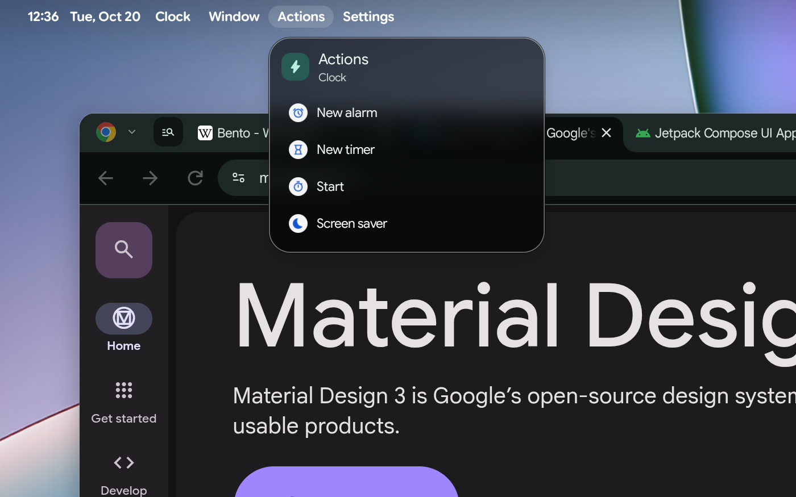
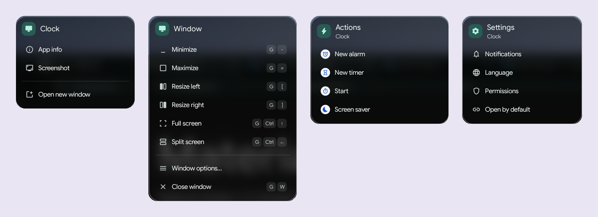

<p align="center">
  
</p>

<h1 align="center">BentoBar fork: the app menu bar</h1>

<p align="center">
  <b>A menu bar for the app in front, right in your Googlebook's status bar.</b><br>
  Click the app's name, Window, Actions, Widgets or Settings beside the clock, as on a desktop: snap, maximize or
  close a window, start an app's quick actions, add its widgets to the home screen, or jump to its notification and
  permission settings.
</p>

<p align="center">
  <a href="../../releases/latest/download/BentoBarFork.apk"><b>⬇ Download BentoBarFork.apk</b></a>
  &nbsp;·&nbsp; <a href="#install">Install</a>
  &nbsp;·&nbsp; <a href="#privacy">Privacy</a>
  &nbsp;·&nbsp; <a href="CHANGELOG.md">What's new</a>
  &nbsp;·&nbsp; <a href="https://github.com/kuscher/bentobar">The original BentoBar</a>
</p>

<p align="center">
  
  
  
  
</p>

<p align="center"><sub>An unofficial fork by <a href="https://github.com/sanjaynathwani-blip">sanjaynathwani-blip</a> of
<a href="https://github.com/kuscher/bentobar">BentoBar</a> by Fika Labs. A personal project, not affiliated with or endorsed by
any employer, or by BentoBar's author (<a href="#about-this-fork">more</a>).</sub></p>

<p align="center">
  
</p>

<p align="center"><b><a href="../../releases/download/menubar-0.1.0/BentoBarFork-demo.mp4">▶ Watch the one-minute demo</a></b>
(MP4, 19 MB): switching apps, Chrome's tabs, the Window menu and Clock's quick actions.</p>

## What it adds

[BentoBar](https://github.com/kuscher/bentobar) puts your own items into the empty part of the
Googlebook's status bar. This fork adds an **app menu bar** to it: right of the clock, the menus of
the app you're using, in the status bar's own font and colour. Switch apps and the menus follow.

| Menu | What's in it |
|---|---|
| **The app's name** (bold) | App info, Screenshot, Open new window |
| **Window** | Minimize, Maximize or Restore, Resize left or right, Full screen, Split screen, Window options and Close, each with the Googlebook's keyboard shortcut beside it |
| **Actions** | the quick actions the app offers on its taskbar icon (New tab, New message, …), for apps that have some |
| **Widgets** | the app's home screen widgets, each with a preview, its size and a **+** that adds it to the home screen, for apps that have some |
| **Settings** | the app's Notifications, Language, Permissions and Open by default pages, one click each |

<p align="center">
  
</p>

- **It follows the app in front.** Over the home screen and while BentoBar is presenting it shows
  nothing; a full-screen app keeps its menus.
- **Menu bar manners:** with one menu open, pointing at another word opens that one.
- **Adding a widget** goes through the home screen's own widget picker, since Android lets only the
  home screen add another app's widget. You see the picker open, turn to the app's page and add the
  widget, at a pace you can follow, and it closes onto the home screen with the widget on it. Opening
  the picker minimises your windows, as the home screen does: click them in the taskbar to bring
  them back.
- **On by default,** and one switch turns it off: **Look › App menu bar**.
- Everything else is BentoBar 1.6 as its author made it: the items, the hidden items behind ‹, Look,
  the Quick Settings tiles. Its [README](https://github.com/kuscher/bentobar#readme) describes all of it.

## Install

The fork installs **beside** BentoBar as its own app, **BentoBar fork**. Running both at once draws
two strips in the status bar, so turn one off (BentoBar's Setup › Turn on, or Android's
Accessibility settings).

1. On your Googlebook, download
   **[BentoBarFork.apk](../../releases/latest/download/BentoBarFork.apk)** from the latest release.
2. Open it from Chrome's downloads or the Files app. If Android asks, allow Chrome (or Files) to
   install apps, then tap **Install**. Google Play Protect may say it hasn't seen this app before:
   tap **More details** › **Install anyway**.
3. Open **BentoBar fork**. It says what its accessibility service reads and asks whether you agree:
   **Agree** opens Android's Accessibility settings.
4. Because it came from a download, Android guards that switch the first time:
   1. Tap **BentoBar fork**, then its switch. Android says *"Restricted setting"*. Tap **OK**.
   2. Back in the app, open **Setup** › **App info**, then **⋮** (top right) › **Allow restricted
      settings**, and confirm with your PIN.
   3. Return to Accessibility › **BentoBar fork** and turn it on.

To check the download, compare it with `SHA256SUMS` in the release:
`sha256sum BentoBarFork.apk`. Every release is signed with the same key, so an update installs over
the old one and keeps your layout.

<a id="privacy"></a>
## Privacy: what the menu bar reads

BentoBar draws on the status bar through an accessibility service, and the original reads only the
status bar's own window. **The app menu bar has to read more**, and the fork's disclosure screen,
accessibility description and About page say so. With **Look › App menu bar** on, it reads:

- **which app is in front:** the active window's package name, to show that app's name and menus;
- **the system's title bar over that window** (its minimize, maximize and close buttons), whose
  buttons the Window menu presses for you;
- **the taskbar's icons and the menu one opens,** only when you start a quick action that only the
  launcher may start: it reads the icons' names (which can include a window's title) to find the
  app's icon, opens its menu and clicks the entry for you;
- **the home screen's widget list,** only when you add a widget from the Widgets menu: it reads the
  list's app and widget names to open that app's page, and presses the widget's Add for you.

It never reads what an app shows inside its window, and doesn't watch your keyboard, mouse or
touches. Nothing it reads is saved or sent anywhere: the release build has no way to send it
(see *Developer extras* below). Switch the menu bar off and none of the above is read.

Everything else is as in BentoBar: it goes online only for the Weather, Air quality, Flight, US stocks
and Exchange rates items, and only after you set them up. [BentoBar's privacy
section](https://github.com/kuscher/bentobar#privacy) has the details.

## Developer extras (not in the download)

Debug builds have two more things that need a helper script running in the Googlebook's Linux
terminal with adb connected to the Googlebook itself (`tools/menubar-bridge.py`):

- a **Tabs** menu for Chrome: the tabs Chrome has loaded in its windows, with Next and Previous,
  through Chrome's remote-debugging socket;
- quick actions that apps publish **while running** (recent chats, for example), from
  `cmd shortcut`.

> **Warning:** while the script runs, *every* app on the device can reach its two ports, not only
> BentoBar: one of them gives full control of Chrome's tabs (their addresses, and running scripts in
> them). Run it only to try the prototype, and stop it when you're done. Release builds never
> connect to it, and the code for it isn't in the APK at all.

## Known issues

- Window menu entries and taskbar actions are matched by the system's **English** labels; in
  another language they show as unavailable.
- The menu bar ignores Look's pill styles and draws plain words.
- With every item hidden or off and **Match the status bar** colour, the menu bar's colour can lag
  when the bar changes.
- Keyboard shortcuts in the Window menu are the Googlebook's defaults; if you changed them in
  the system's Keyboard shortcuts, the menu still shows the defaults.
- **Widgets › +** opens the widget picker the way the Googlebook's (Pixel) launcher opens it itself,
  which no document promises: a launcher update could stop it. If the picker doesn't open, a toast
  says how to add the widget by hand (right-click the home screen › Browse widgets).
- Tested on one Googlebook (ASUS Googlebook 14). Others may differ.

## Build

Needs JDK 21 and the Android SDK (platform 37).

```sh
./gradlew :app:assembleDebug      # app/build/outputs/apk/debug/app-debug.apk (id …menubar.dev)
./gradlew :app:assembleRelease    # signed if ~/.config/bentobar-fork/keystore.jks and keystore.pass exist
./gradlew :app:testDebugUnitTest
```

The menu bar lives in `bar/AppMenuBar.kt` (menus and reading the front window), `bar/FrontAppRules.kt`
(which app the menus are for: pure, unit-tested from real Googlebook window lists) and
`bar/AppActions.kt` (quick actions), `bar/AppWidgets.kt` (the Widgets menu) and `bar/WidgetAddRules.kt`
with `bar/WidgetAdder.kt` (adding a widget through the picker: pure, unit-tested steps). [CLAUDE.md](CLAUDE.md) is BentoBar's own guide to the code.

## About this fork

This fork is a personal project by [sanjaynathwani-blip](https://github.com/sanjaynathwani-blip),
made to try an idea in real code: a desktop-style menu bar for the app in front. It has no
affiliation with my employer: my employer didn't make, sponsor, review or endorse it, and nothing
here speaks for my employer.

**BentoBar is Fika Labs' work**, and the menu bar wouldn't exist without it. This fork isn't made,
reviewed or endorsed by BentoBar's author; please report anything about the menu bar
[here](../../issues), not to BentoBar. The menu bar breaks a rule BentoBar keeps on purpose ("reads
only the status bar"), which is why it lives in a fork.

Googlebook and Chrome are trademarks of Google LLC, named only to describe what the fork works with.

## License

Like BentoBar, the fork is free software under the [MIT License](LICENSE) (copyright Fika Labs, and
the fork's changes by sanjaynathwani-blip). It includes Google's
[Material Symbols](https://fonts.google.com/icons) (Apache License 2.0) and uses Jetpack Compose,
AndroidX, Kotlin and kotlinx.serialization (Apache License 2.0).
